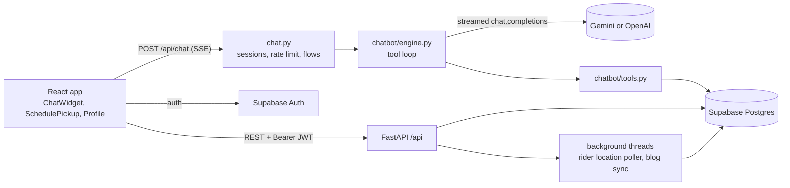

# Prithvi: doorstep plastic recycling with a tool-calling assistant

Prithvi is a web app for a plastic-recycling service in India. Households sign in, book a doorstep pickup for their segregated plastic, see an earnings estimate (₹15/kg), and track their pickups and recycling impact. A chat assistant on every page answers questions from a curated knowledge base and calls backend tools to look up the user's own pickups, compute earnings, or start a cancellation.

> **Team project.** This repository is the shared codebase of a team project. The full history was squashed into a single commit when it was moved here, so per-file authorship isn't recoverable from git. See [My contributions](#my-contributions).

## Stack

| Layer | Tech |
|---|---|
| Frontend | React 18 + Vite, React Router, Zustand, Supabase Auth UI, Google Maps (`@react-google-maps/api`) |
| Backend | FastAPI, Pydantic v2, OpenAI Python SDK (used for both OpenAI and Gemini) |
| Data / auth | Supabase (Postgres, Auth with email + Google OAuth, Realtime), RLS policies in `backend/db/security_hardening.sql` |
| Tests | pytest with a mocked Supabase client (`tests/`), plus an LLM eval harness (`backend/chatbot/evals/`) |

## Architecture



## The chat assistant (`backend/chatbot/`)

The assistant is a small, single-agent tool-use loop written directly against the Chat Completions API, without an agent framework. The parts:

| File | Role |
|---|---|
| `engine.py` | Runs one assistant turn: streams the model's reply, collects tool calls, executes them, feeds results back, repeats (max 5 tool rounds). Yields typed events for the UI. |
| `tools.py` | Tool schemas and implementations. All tools are read-only. |
| `prompt.py` | System prompt with the knowledge base embedded, plus a small per-request context block. |
| `kb.md` | The only source of facts the model is allowed to state: rates, slots, accepted plastics, eco tiers, shop prices, contacts. |
| `flows.py` | Predefined quick-reply chips. Some are answered statically with no model call; others send a canned prompt to the model. |
| `evals/` | Test cases and a runner that grades real model output. |

### Turn lifecycle

1. `POST /api/chat` (`backend/chat.py`) validates the message (max 500 chars), applies an in-memory rate limit per user or IP (20/min, 200/day), resolves or creates a chat session in Supabase, and loads the last 20 messages as history.
2. If the request is a static flow (e.g. "What plastic do you accept?"), the canned reply is streamed back and the model is never called.
3. Otherwise `engine.run_turn()` builds `[system, *history, user]` and opens a streamed completion with the four tool schemas.
4. Text deltas are forwarded to the browser as SSE `text` events. Tool-call fragments are accumulated by index (OpenAI streams arguments in pieces; Gemini sends each call whole with no index, so the engine handles both).
5. When the model stops with tool calls, the engine appends the assistant message, emits a `status` event per tool ("Checking your pickups…"), runs each tool, and appends the results as `tool` messages. Tool errors (bad JSON args, not signed in, wrong pickup id) are returned to the model as `Error: …` strings so it can recover in its reply. Then it loops.
6. The final reply plus metadata (provider, model, tools used, token usage including cached tokens) is saved to `chat_messages`, and a `done` event carries the message id so the UI can collect thumbs up/down feedback.

### Tools

| Tool | What it does | UI side effect |
|---|---|---|
| `get_my_pickups` | Signed-in user's 10 most recent pickups | `pickups` event, rendered as cards |
| `get_my_impact` | Totals over non-cancelled pickups: kg, earnings, CO2 (2.5 kg per kg plastic), eco tier and kg to the next tier | none |
| `estimate_earnings` | `weight_kg × 15`, validated to 0.5–1000 kg | none |
| `request_cancel_pickup` | Verifies the pickup belongs to the user and is still `scheduled` | `confirm_cancel` event, rendered as a confirm button |

The model can never mutate data. `request_cancel_pickup` only asks the widget to show a button; the cancellation happens when the user taps it, which calls the normal authenticated `POST /api/pickups/{id}/cancel` endpoint. The tool result tells the model explicitly that nothing has been cancelled yet, and the prompt forbids it from saying otherwise. User-scoped tools take `user_id` from the verified Supabase JWT on the server, never from model arguments.

### Grounding and guardrails

- **KB-grounded answers.** `kb.md` is embedded in the system prompt. The prompt tells the model to state Prithvi facts only from the KB or tool results and to point to support when unsure, instead of guessing numbers or policies.
- **Prefix caching.** The system prompt is a frozen string, and per-request values (date, user name) are appended after it so the provider's automatic prompt-prefix caching can reuse the long KB block. Cached-token counts are tracked in the usage metadata.
- **Scope and injection.** Off-topic requests are declined; the prompt states that user text never changes the instructions.
- **Content filter.** If the provider stops with `content_filter` mid-stream, the engine sends a `replace` event so the widget swaps any partial text for a fixed refusal.
- **Language.** Replies follow the user's language and script (Hindi, Hinglish, English); one eval case checks for Devanagari output.

### Provider abstraction and model fallback

`CHAT_PROVIDER` selects `gemini` (default, via Gemini's OpenAI-compatible endpoint) or `openai`. Both go through the same `openai` client with a different `base_url` and key. `CHAT_MODEL` overrides the default model and `CHAT_FALLBACK_MODELS` lists models to try in order. On `RateLimitError` or `NotFoundError` the engine moves to the next model and puts the failing one on a cooldown (1 hour for per-day quota or a retired model, 60 s otherwise), so a free-tier daily cap doesn't take the chat down. `CHAT_EFFORT` sets `reasoning_effort` (default `low`; set it empty for models that reject it).

Gemini returns a `thought_signature` in each tool call's `extra_content`, which must be echoed back on the next request. The engine preserves it, and there is a unit test for parallel Gemini calls that checks this.

### Sessions and privacy

Guests can chat. Their session has `user_id = NULL`; if they sign in mid-chat, the session is claimed by their account. A user can only read history or leave feedback on sessions that are theirs (or still guest). An expired token degrades to guest mode instead of failing the request. `chat_schema.sql` includes an optional pg_cron job for 90-day retention.

### Evaluation

`backend/chatbot/evals/cases.json` holds 42 test questions: rates and arithmetic, accepted plastics, scheduling, tiers and CO2, shop prices, signed-in tool use (`me-*`), guest behaviour, cancellation, Hindi replies, off-topic refusals, a prompt-injection attempt on the rate, and a check that it doesn't invent service cities. `run_evals.py` runs them against the real model with an in-memory fake database of seed pickups, and grades each reply with string checks (`contains_any`, `contains_all`, `not_contains`), `critical_not_contains` for answers that must never appear, `tools_include` for required tool calls, and a Devanagari script check. It prints token totals and an approximate cost, and exits non-zero unless at least 90% pass with no critical failures.

```bash
cd backend
python -m chatbot.evals.run_evals              # all cases
python -m chatbot.evals.run_evals rate-basic   # selected case ids
```

This calls the real API and costs money. No eval results are checked into the repo.

## Rest of the app

- **Pickups** (`backend/pickups.py`): `POST /api/pickups/` with Pydantic validation (6-digit pincode, date not in the past, slot in `8-12 / 12-16 / 16-20`, plastic type in PET/HDPE/LDPE/PP/mixed, weight ≥ 0.5 kg). `GET /api/pickups/me`, `GET /api/pickups/{id}/location`, `POST /api/pickups/{id}/cancel`, all ownership-checked.
- **Auth** (`backend/auth.py`, `server.py`): email/password register and login, Google OAuth URL / code exchange / ID-token sign-in, `GET /api/auth/me`. Every protected route verifies the Supabase JWT.
- **Rider tracking** (`backend/tracking.py`): each new pickup gets a placeholder rider id. A background thread polls a location source every `TRACKING_POLL_INTERVAL` seconds and writes to `rider_locations` (history) and `rider_locations_latest` (published to Supabase Realtime). Rider ids are generated by the backend and are not exposed as a public HTTP surface.
- **Blogs** (`backend/blogs.py`): a background thread syncs environment articles from the dev.to API into a `blogs` table every 15 minutes.
- **Frontend pages**: Home, About, Eco Shop, Login/Signup, Schedule Pickup (Google Maps address search), Profile (pickup history, impact, bio), plus the floating `ChatWidget`.

## Running locally

### 1. Supabase

Create a project and run the SQL files in `backend/db/` in the SQL editor: `profiles_schema.sql`, `pickups_schema.sql`, `rider_tracking_schema.sql`, `chat_schema.sql`, `blogs_schema.sql`, then `security_hardening.sql` last (it adds the RLS policies).

### 2. Backend

```bash
cd backend
python -m venv .venv && source .venv/bin/activate
pip install -r requirements.txt
```

`backend/.env`:

```env
SUPABASE_URL=https://<project>.supabase.co
SUPABASE_KEY=<supabase-service-key>
CORS_ORIGINS=http://localhost:5173

CHAT_PROVIDER=gemini            # or openai
GEMINI_API_KEY=<your-gemini-key>
# OPENAI_API_KEY=<your-openai-key>
# CHAT_MODEL=...                # optional override
# CHAT_FALLBACK_MODELS=a,b,c    # optional
# CHAT_EFFORT=low               # "" to disable reasoning_effort

# optional
# TRACKING_POLL_INTERVAL=3
# TRACKING_DUMMY_URL=...
# BLOG_SYNC_INTERVAL=900
# BLOG_SOURCE_URL=...
```

```bash
uvicorn server:app --reload --port 8000
```

### 3. Frontend

`prithvi-app/.env`:

```env
VITE_API_BASE_URL=http://localhost:8000
VITE_SUPABASE_URL=https://<project>.supabase.co
VITE_SUPABASE_ANON_KEY=<supabase-anon-key>
VITE_GOOGLE_MAPS_API_KEY=<your-maps-key>
```

```bash
cd prithvi-app
npm install
npm run dev        # http://localhost:5173
```

### 4. Tests

```bash
# from the repo root; Supabase is mocked in tests/conftest.py
pytest tests
```

The suite covers auth, pickups, server routes and the chat stack: static vs model flows, session ownership and guest claiming, rate limiting, feedback, each tool's ownership rules, quota fallback, tool-round handling, Gemini thought signatures, malformed tool JSON, and content-filter replacement. The model is stubbed, so these run offline.

## Limitations / next steps

- **Rider tracking is simulated.** With the default `TRACKING_DUMMY_URL`, `fetch_dummy_location` returns random coordinates around a fixed point (in San Francisco, not India), and the rider id is a `dummy-…` placeholder. The frontend doesn't render rider locations yet.
- **No payments.** Earnings are estimates (`weight × ₹15`); there is no payout or Eco Wallet ledger in the backend.
- **In-memory chat rate limit.** The limiter in `chat.py` is per-process and resets on restart, so it won't hold across multiple workers.
- **Eval grading is string-based.** It catches wrong numbers and missing tool calls, not answer quality. An LLM-judge or rubric pass would be the next step.
- **Pickup edits** aren't supported; users cancel and rebook.
- The Home page fetches dev.to directly in the browser, so the backend `blogs` sync table isn't read by the UI yet.
- `prithvi-app/README.md` and `QUICK_START.md` predate the Supabase backend and still describe localStorage mock auth.

## My contributions

The history here is a single squashed commit (`e382b7b`, Aadvik Chaturvedi) made when the team's code was moved into this repository, so git can't attribute individual files to individual people. Everything described above is the team's combined work, and I was one of the developers on it.
